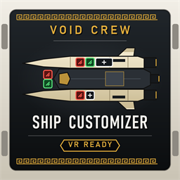

# Void Crew Ship Customizer

A BepInEx mod for **Void Crew** that adds a **CUSTOM** loadout to the hub's ship loadout terminal. Fit any weapon or
module, of any tier, on every hardpoint of your ship, choose what it starts with on its storage racks, and pick the
homunculus: a sandbox for builds the regular loadouts never offer.

Works on every ship (Frigate, Striker, Destroyer), on a monitor or in VR.

## Download

- **Thunderstore** (recommended): install **Ship Customizer** for Void Crew with r2modman, Gale or the Thunderstore Mod
  Manager. BepInEx is installed for you.
- **Manual**: download `VoidCrewShipCustomizer.dll` from the
  [Releases](https://github.com/CaptainChunck/VoidCrewShipCustomizer/releases) page and put it in your BepInEx `plugins`
  folder (see [Manual install](#manual-install)).

## What it does

- **A CUSTOM entry** at the bottom of the LOADOUTS list, for every ship. It starts as a copy of ROOKIE.
- **Clickable hardpoints.** Every free hardpoint on the ship picture shows a **+**. Click a hardpoint (empty or not) for a
  list of every weapon and module that fits it, from Mk I to Mk III, with rarity colours and the game's own tooltips,
  sorted into WEAPONS, DEFENSE and SUPPORT tabs.
  - A 2x1 hardpoint takes one 2x1 module, or two 1x1 modules side by side, as in the game.
  - The game's "only one of these per ship" rule still applies (marked ONE PER SHIP).
  - Each choice shows the power it draws (or, for a generator, makes), and the lists show the ship's total: **Power: 18
    of 24 made** (the game's base values).
  - **CONTENTS** (on a fitted weapon or module): what it starts loaded with. Pick an item for each of its slots (ammo
    crates or batteries for a weapon, as its type takes, weapon mods, power cells for shields and charge stations,
    payloads for the payload launcher); only what fits a slot is listed. USUAL CONTENTS keeps what the game's own
    loadouts load it with.
- **A CUSTOM section above SELECT** while CUSTOM is shown, in the terminal's own style:
  - **HARDPOINTS**: every hardpoint as a big, numbered row (port or starboard, bow to aft, with what is fitted and what it
    is loaded with). After a pick it comes back where it was. Easy to use in VR.
  - **STORAGE**: every storage rack and slot. Any item fits any slot: ammo, power cells, repair plates, materials, animus
    crates, weapon crates (an inscribed crate that builds that weapon on any free hardpoint), weapon mods or relics.
    During a CUSTOM run the racks take any item too.
    **Drag a filled slot onto another slot** (on the same rack or another one) to copy its item there, replacing what was
    there; a click still opens the list. A slot that won't take the item lights up red and says why, as its list would.
  - **HOMUNCULUS**: the standard homunculus, or any Blessed Homunculus from the game's loadouts. Each one shows what its
    blessing does (the text of the game's tooltip), so there's no need to hover over each one.
  - **FABRICATOR**: how many alloys the run starts with (the game's own amount, or 0 to 10,000), and the fabricator's
    level, MK I to MK III.
  - **SAVE LOADOUT**: keep this CUSTOM loadout on your PC, in one of 10 slots per ship, to bring back in any later
    match (replacing or clearing a slot asks for a second click). Works on a loadout you can only look at, too.
    **COPY AS A SHARE CODE** puts the whole loadout on the clipboard as one line of text, to paste in a chat.
  - **LOAD LOADOUT**: replace the CUSTOM loadout with one you saved, a **share code** someone sent you (PASTE A SHARE
    CODE), any of the game's loadouts (the challenge ones included), or an empty ship (all hardpoints, all racks, or
    everything), then change what you like.
- **Pop-up windows like the game's own**: the pickers and the storage-rack window are built from the game's pop-up and
  list styles (its dark-grey window with the light-blue outline, list rows and buttons).
- **Works with [Void Crew Fleet](https://thunderstore.io/c/void-crew/)**: every player ship Fleet adds can use CUSTOM
  too: up to 3 ships in co-op and up to 3 a team in a Fleet Battle with Void Crew Fleet 0.4.0 or newer (ship 2 with an
  older Fleet). Each ship has a CUSTOM layout and fabricator level of its own, set up under that ship on the terminal,
  and SELECT under that ship makes it use CUSTOM. Any player can set the ships up. With Void Crew Fleet 0.2.1 or newer,
  each ship can also start with alloys of its own.
  - In co-op, a ship's layout is the same as ship 1's until you change it under that ship (LOAD LOADOUT > SAME AS SHIP 1
    goes back). LOAD LOADOUT can also copy another ship's CUSTOM once.
  - CUSTOM on ships 3 to 6 needs everyone in the room on Ship Customizer 0.9.0 or newer. Ships 1 and 2 work with older
    versions as before.
  - When the host makes a ship a given type (Void Crew Fleet 0.4.0), only that type's CUSTOM is offered for it.
  - In a **Fleet Battle** (PvP), the odd ships (BLUE 1, 2, 3) belong to the BLUE team and the even ships (RED 1, 2, 3)
    to the RED team: only a ship's own team can change its CUSTOM loadout, and the other team sees it view-only. The
    CUSTOM pop-ups take the team's colour. No ship follows or copies the other team's CUSTOM: a ship's layout starts from
    its type's default loadout until its team changes it.
  - **Match rules keep a Fleet Battle even.** A CUSTOM ship never starts with relics, the Armory Exchange Key, extra
    Fabricator modules or the game's unfinished Placeholder weapons; the menus leave them out (no RELICS tab). Relics
    found during the match are yours to use.
  - With Void Crew Fleet 0.3.0 or newer, the host sets the rest on Fleet's lobby screen (SHIP RULES): which tiers,
    categories and single items CUSTOM may use, the fabricator's highest level and the most starting alloys. The menus
    grey out what the rules refuse (NOT ALLOWED IN THIS MATCH).
  - A **MATCH RULES** button above the CUSTOM section shows the rules and what the loadout has that breaks them
    (BREAKS MATCH RULES), and can take it off. When the mission starts, the host takes off whatever still breaks them
    (your saved loadouts keep everything) and everyone with Ship Customizer is told in the chat.
  - Fleet's features only apply when the host runs Fleet too. Without Fleet (not installed, turned off in its config, or
    not running on the host), all of this stays off and out of sight, and Ship Customizer works on its own.
- Your CUSTOM loadouts are saved per ship in
  `%USERPROFILE%\AppData\LocalLow\Hutlihut Games ApS\Void Crew\ShipCustomizer\custom-loadouts.json`, and the loadouts
  you save with SAVE LOADOUT in `saved-loadouts.json` next to it.

## Multiplayer and the modding rules

Ship Customizer follows Void Crew's
[official modding guidelines](https://steamcommunity.com/app/1063420/discussions/0/6057990917770747901/) for sandbox mods:

- **Every player with Ship Customizer can choose CUSTOM and change it**, and **everyone in the room needs Ship
  Customizer** for it. If someone without the mod joins while CUSTOM is chosen, the room goes back to ROOKIE (nobody is
  kicked).
- Rooms you host are marked **[mod_session]** in the server list, the game's tag for mods that change the session.
  Players need "Can join [mod_session] games" turned on to join them.
- **A CUSTOM run gives nobody XP, rewards, quest progress, achievements, stats or daily and weekly quest progress**, from
  the moment the mission starts until everyone is back in the hub (also after the host leaves mid-run). The room is
  closed to new players during a CUSTOM mission. A saved CUSTOM run stays without progression when you continue it, and
  only starts while everyone in the room has the mod.
- The CUSTOM loadouts are the host's. Everyone sees and changes the host's, and the changes are saved on the host's PC.
  LOAD LOADOUT has your saved loadouts and **YOUR OWN CUSTOM**, to bring in what's on your PC.
- **Several players can set up the same ship together.** Every player's terminal shows what the room has chosen for the
  ship it sets up, and moves along when anyone picks another loadout or CUSTOM (not while you're looking at another
  loadout; it catches up when you start using the terminal again). Open lists update when someone else changes the
  loadout. Changes are made part by part (each hardpoint, each rack slot, the homunculus, the alloys, the fabricator
  level), so changes to different parts all stay. If two players change the same part at the same moment, the first
  change stays and the other player is told who got there first, so nobody's change is silently replaced. Everyone is
  told who changed the loadout. Just after you join, the terminal says WAITING FOR HOST until the host's CUSTOM loadouts
  arrive.
- With a host on Ship Customizer 0.4.0 or older, only the host can choose or change CUSTOM; everyone else sees it.

## Manual install

You need BepInEx 5 for Void Crew (the Thunderstore BepInExPack, or BepInEx 5.4.23 from GitHub). VR players using Rai Pal
already have it.

1. Download `VoidCrewShipCustomizer.dll` from [Releases](https://github.com/CaptainChunck/VoidCrewShipCustomizer/releases).
2. Copy it into your BepInEx `plugins` folder:
   - Plain BepInEx: `...\steamapps\common\Void Crew\BepInEx\plugins`
   - Rai Pal (VR): `%APPDATA%\raicuparta\rai-pal\data\installed-mods\<number>\bepinex\BepInEx\plugins` (the number is on
     the `target_assembly` line of `Void Crew\doorstop_config.ini`).
3. Start the game. `BepInEx\LogOutput.log` should say
   `All game patches are in; the CUSTOM loadout is available at the ship loadout terminal.`

To remove it, delete the DLL. Your saved CUSTOM loadouts stay in the save folder and do nothing without the mod.

## Settings

`BepInEx\config\com.captainchunck.voidcrew.shipcustomizer.cfg` (created on first start):

| Setting | Default | What it does |
|---|---|---|
| General > Enabled | true | Turn the mod off without removing it. |
| Rules > AllowAnySize | false | Let any module go in any hardpoint, whatever its size. Big modules in small hardpoints can stick through walls. |
| Rules > AnyItemOnAnyRack | true | Any item goes in any storage rack slot, in the CUSTOM editor and during a CUSTOM run. Turn off to keep each rack's usual rules. |
| Rules > CopyPresetModuleContents | true | A module that one of the game's loadouts also uses starts with the same contents (loaded ammo crate, power cell). |
| Rules > ShowQuestItems | false | List quest items in the storage picker. They can confuse mission objectives. |
| Diagnostics > WriteGameDataReport | true | After an update of the mod or the game, write everything the mod found to `ShipCustomizer\game-data.txt` in the save folder (when the terminal first loads). |
| Diagnostics > VerboseLogging | false | Extra detail in the BepInEx log. |

## Known limits

- The pop-up lists work with the mouse (or a VR pointer); gamepad navigation isn't supported yet.
- In VR the terminal pointer can drift from where clicks land when you turn your head, so small targets such as the
  hardpoint icons are hard to hit. Use **HARDPOINTS** instead; its rows are large.
- The first time the terminal opens, the mod reads every module and weapon from the game, which takes a second or two.
- Crates sitting unbuilt on a hardpoint in a game loadout are not copied by LOAD LOADOUT.

## Bug reports

Please open an [issue](https://github.com/CaptainChunck/VoidCrewShipCustomizer/issues) and attach `BepInEx\LogOutput.log`
and `ShipCustomizer\game-data.txt` from `%USERPROFILE%\AppData\LocalLow\Hutlihut Games ApS\Void Crew`.

## Building from source

Open `VoidCrewShipCustomizer.slnx` in Visual Studio 2026 (or run MSBuild) and build **Release**. The project references
the game's and BepInEx's DLLs from your install (they are not in this repository); if yours are elsewhere, change
`VoidCrewDir` and `BepInExDir` at the top of `VoidCrewShipCustomizer\VoidCrewShipCustomizer.csproj`.

- `tests\build-and-test.ps1` builds Release and runs the offline checks against your game's assemblies (no game needed):
  every game member the mod looks up by name must exist, and the hardpoint rules and save format must behave.
- `tools\package.ps1` builds Release and writes the Thunderstore upload to `dist\VoidCrewShipCustomizer-<version>.zip`.
- `tools\make-icon.ps1` redraws `thunderstore\icon.png`.

## How it works (for modders)

- Each ship gets a `ShipLoadoutDataDef` of its own, backed by a runtime `ShipLoadoutData` registered with the game's
  `RuntimeAssetsRegister` (effect None, so joining players aren't required to have it). The terminal lists, draws and
  describes it with its own code.
- A CUSTOM loadout is built on the game's default loadout (`ShipLoadoutDataContainer.GetDefault()`, ROOKIE) when that is
  for the same ship, otherwise on the lowest-rank loadout the terminal lists. The game's challenge and test loadouts are
  never used for this.
- Picking CUSTOM selects the loadout it stands in for (`HubShipManager.SelectShip`, which also sends another player's
  pick to the host), so no player ever receives an unknown loadout id. Modded players learn about CUSTOM through the room
  property `SC_Custom` (`SC_Custom2` to `SC_Custom6` for Fleet's ships); `SC_Run` marks a CUSTOM mission and `SC_Closed`
  a room closed for one. Each modded player sets the player property `SC_Player` to its protocol (4 from 0.9.0, 3 from
  0.8.0, 2 from 0.5.0, 1 before).
- Shared editing (0.5.0): once a 0.5.0 player is in the room, the host shares each ship type's CUSTOM loadout per player
  ship as the room properties `SC_Layout<n>_<ship GUID>`, n from 1 to 6 (ships 2 to 6 only when they have their own).
  Other players send a change as the player property `SC_Edit<n>_<ship GUID>`: the whole loadout, addressed to the room
  and the host. The host keeps only what the ship has and what its settings allow (`Sanitize`), saves it and shares it
  again.
- Merged changes (0.8.0, protocol 3, `LayoutMerge`): a change also carries `Base`, the host's loadout as the player last
  read it. The host merges it part by part (each hardpoint group with its module's contents, each rack slot, the
  homunculus, the alloys, the fabricator level): a part the player changed is taken unless someone else changed it since
  `Base`, in which case it is refused and the shared layout's `Refused` names it (and who changed it first). Changes
  without `Base` (0.7.x and older) replace the whole loadout, as before.
- Module contents (0.8.0): chosen contents are kept per hardpoint (`HullConfig.Contents`). The CUSTOM ship spawns with
  those modules empty, and the host puts the items in once the ship is in the world, into the module's real
  `CarryablesSockets`, each only where that socket accepts it.
- Share codes (0.8.0, `ShareCodes`): `SC1-` and the loadout's JSON, deflated and in URL-safe base64. Pasting one runs it
  through `Sanitize` like a change from another player.
- Starting alloys go through `GameSession.InitialAlloys`. The fabricator's level is set with
  `FabricatorModule.SetFabricatorTier` once the ship is in the world, as the game does when continuing a saved run.
- During a CUSTOM run, a prefix on `CarryablesSocket.DoesAccept` lets storage rack slots take any item. The game checks it
  only on the player putting the item in; at mission start it fills the racks without checking.
- Void Crew Fleet is optional and found through reflection (`FleetLink`): installed and turned on (its General > Enabled),
  looked up once the hub has loaded. Its features only apply while the host runs it too: a 0.9.0 host says so in the
  room property `SC_Fleet` (with an older host, Fleet's own checks decide). Its `VoidCrewFleet.FleetApi` (`IsTeamMatch`,
  `TeamOfShip`, `CanEditShip`, `ShipColor`, `TeamsChanged`) gives the Fleet Battle team rules. The terminal follows them,
  and the host refuses changes from the wrong team. Fleet 0.4.0's `ShipCount`, `HullOfShip`, `ShipName` and
  `ShipsChanged` add ships 3 to 6 and the types the host forces. Without Fleet, its ships and the team rules are off.
- Ships 3 to 6 (0.9.0, protocol 4): their own layouts are saved in `custom-loadouts.json` under `MoreShips`. In co-op a
  ship without one follows ship 1's; in a Fleet Battle it starts from the stand-in game loadout, so no team follows the
  other's. Fleet 0.4.0 spawns its co-op copies of ship 1 from the very `ShipLoadout` ship 1 got, so the host matches
  spawned ships to their CUSTOM plans by reference only (by contents only with an older Fleet).
- Fleet Battle match rules (0.7.0, `MatchRules`): what a Fleet Battle never allows is fixed here (relics, the Armory
  Exchange Key, the Fabricator modules, Placeholder weapons, crates and mods). The host's rules come from Fleet 0.3.0's
  `ShipRulesActive`, `IsTierAllowed`, `IsCategoryAllowed`, `IsItemAllowed`, `FabricatorMaxLevel`, `MaxStartAlloys` and
  `ShipRulesChanged`, and Fleet's SHIP RULES tab lists what `GetRuleOptions` returns. At mission start the host applies
  them to a copy of each CUSTOM loadout and sets the room property `SC_Notice` (`{N, T, Text}`), which every player with
  the mod shows in the chat once the mission has loaded.
- When the mission starts (`GSIngame.TransitionTo`), the host swaps the session's `ToLoadShipData` for a `ShipLoadout`
  built from the CUSTOM choices, and the game's own `ShipLoadout.InitializeShip` spawns it for everyone. Anything the game
  could not spawn is left out with a warning instead of stopping the mission from starting.
- Progression is paused by skipping `PlayerRewardsCollection.AddItem` (a run's XP only arrives as reward items),
  achievements, quest progress, tracked stats (`TrackedMetric`, every `SubmitProgress`) and daily and weekly quests
  (`Metaquest`) during CUSTOM runs. The room property `SC_RunId` (trusted from hosts on 0.8.0 or newer) holds the CUSTOM
  run's session id, so a player who becomes host mid-run keeps it paused and remembers the run, and a flag left behind
  never pauses a later mission. Leaving the room mid-run keeps the pause until the hub or another mission: the game saves
  a mission's stats while unloading it (`PlayerMetricTracker.OnDisable`), after the room is gone. Every Harmony patch is
  looked up by name and applied on its own, so a game update turns CUSTOM off instead of breaking the game. CUSTOM is
  only offered while the rewards hook and at least one hook for every other kind of progression are in: achievements,
  quest progress, tracked and Steam stats during a mission (`TrackedMetric`) and as it ends (Steam's `SubmitProgress`,
  the profile's outer wrapper), daily and weekly quests, and the start of a saved CUSTOM run
  (`HubQuestManager.StartQuest`). The log names any kind left without one; a player whose hooks are missing doesn't
  count as having the mod.
- A CUSTOM loadout's ship for the terminal is built just before the terminal shows it (a `Display` prefix), and the
  room's choice when the game asks for it, so loading the hub reads no modules. Remote changes redraw the terminal once
  per frame at most, and the room's choice is only told around the hub again when ship 1's choice itself changes.
- Saving: `SafeFile` writes to `.tmp`, flushed to the disk, then replaces the file and keeps the one before as `.bak`. An
  empty or damaged file is kept as `.broken` and the `.bak` (then the `.tmp`) is read instead. Loadout changes are saved
  a second after the last one, straight away before a mission and when the game closes. A write that fails (a virus
  scanner or backup tool holding the file) keeps the changes waiting: it is tried again 5 seconds later (less often while
  it keeps failing), and straight away (a CUSTOM run to remember, a mission starting, the game closing) a few times a
  moment apart. Fields from a newer version are kept (`[JsonExtensionData]`).

### Public API for other mods

`VoidCrewShipCustomizer.ShipCustomizerApi` is meant to be reached through reflection (find the plugin with GUID
`com.captainchunck.voidcrew.shipcustomizer` in `Chainloader.PluginInfos`), so neither mod needs the other. Check
`ApiVersion` (currently `1`) first. No member throws. Void Crew Fleet uses it for its extra player ships: ship 1 is the
game's own, ships 2 to 6 are Fleet's (odd ships BLUE, even ships RED in a Fleet Battle).

| Member | What it does |
|---|---|
| `const int ApiVersion` | Raised when a member changes in a way older callers don't understand. |
| `ShipLoadoutDataDef GetDef(GUIDUnion)` | The CUSTOM definition behind a GUID (created on first use), or null if it isn't CUSTOM. |
| `ShipLoadoutDataDef GetStandIn(GUIDUnion)` | The game loadout a CUSTOM loadout is built on and shown as to players without the mod. |
| `ShipLoadoutDataDef GetDefaultLoadout(GUIDUnion shipGuid)` | A ship type's default game loadout (the one CUSTOM stands in with: ROOKIE, or the lowest-rank listed one; never a challenge or test loadout), or null (0.9.0). |
| `void SetTerminalShip(int)` | 1 to 6: which ship's CUSTOM layout the loadout terminal shows, edits and saves (3 to 6 from 0.9.0). |
| `string CheckShip(int ship, GUIDUnion, int actorNumber)` | Host: null if that player may give ship 2 to 6 this CUSTOM loadout now, otherwise the reason (0.9.0). Ships 3 to 6 need everyone on 0.9.0 or newer; a ship the host makes a given type only takes that type's CUSTOM. |
| `void SetShip(int ship, GUIDUnion)` | Host: ship 2 to 6 now uses this loadout (CUSTOM or not); other players with the mod see its layout (0.9.0). |
| `ShipLoadout BuildShip(int ship, GUIDUnion)` | Host, from a `GSIngame.TransitionTo` prefix that runs after this plugin's: ship 2 to 6's CUSTOM `ShipLoadout`, or null (use the stand-in). Makes the run a CUSTOM run; Fleet Battle match rules apply (0.9.0). |
| `int GetShipAlloys(int ship, GUIDUnion)` | Host, at mission start: the alloys ship 2 to 6's CUSTOM loadout starts with, or -1 for the game's own amount (0.9.0). In a Fleet Battle, within the match rules. |
| `event Action<int> ShipCustomCancelled` | Host: that ship's (2 to 6) CUSTOM was switched off in the hub because someone without the mod (or, for ships 3 to 6, with a version older than 0.9.0) joined (0.9.0). |
| `string CheckShip2(GUIDUnion, int)`, `void SetShip2(GUIDUnion)`, `ShipLoadout BuildShip2(GUIDUnion)`, `int GetShip2Alloys(GUIDUnion)` | The same for ship 2 (0.4.0 to 0.5.1; kept for older Fleets). |
| `event Action Ship2CustomCancelled` | Ship 2's CUSTOM was switched off; raised together with `ShipCustomCancelled(2)` (kept for older Fleets). |
| `string[] GetRuleOptions()` | What a Fleet Battle's match rules can allow or refuse, one `code\|category\|tier\|name` line each; empty until the hub has loaded (0.7.0). |

## License

This mod's source code is released under the [GNU General Public License v3.0](LICENSE). Void Crew, BepInEx and HarmonyX
aren't part of this repository and keep their own licenses.
